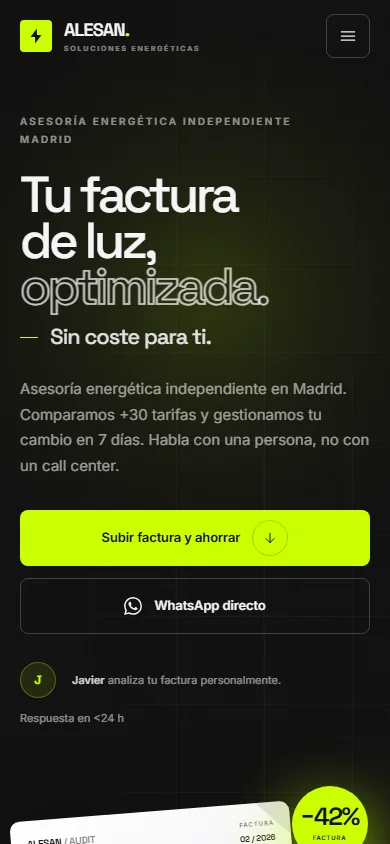

# Alesan Soluciones — Landing

Rediseño de la landing page de **Alesan Soluciones**, asesoría energética independiente en Madrid.

Dirección de arte *streetwear minimalista* aplicada a un servicio profesional: off-black, mucho aire, tipografía editorial, un único acento lima y visuales construidos con CSS/SVG en lugar de fotografía de stock.




## Stack

- **HTML5 semántico** y accesible.
- **Tailwind CSS 3.4** compilado localmente (sin CDN en producción).
- **JavaScript vanilla**, sin dependencias en runtime: menú móvil, reveals, barras de ahorro y año dinámico.
- **Space Grotesk + Inter** autoalojadas en WOFF2 (sin peticiones a Google Fonts).
- Iconografía SVG inline (sprite único, sin librerías externas).
- **Open Graph image** generada para compartir la página.

## Empezar

Requisitos: Node.js 18+ y pnpm (o npm).

```bash
pnpm install
pnpm build
pnpm preview
```

La landing queda disponible en `http://localhost:4173`.

Para trabajar con recarga de estilos:

```bash
# Terminal 1: compila Tailwind en modo watch
pnpm dev

# Terminal 2: sirve el sitio estático
pnpm preview
```

Con npm:

```bash
npm install
npm run build
npm run preview
```

> `assets/styles.css` se genera a partir de `src/input.css`. No lo edites a mano: ejecuta `pnpm build` después de cualquier cambio.

## Estructura

```text
alesan-soluciones/
├── assets/
│   ├── fonts/               # Space Grotesk e Inter (WOFF2)
│   ├── favicon.svg
│   ├── main.js              # Interacciones sin dependencias
│   ├── og-image.jpg         # Imagen para redes (1200 × 630)
│   └── styles.css           # CSS compilado y minificado
├── docs/                    # Capturas para el README
├── scripts/
│   └── serve.mjs            # Servidor estático local sin dependencias
├── src/
│   └── input.css            # Tokens, componentes y animaciones
├── index.html               # Landing completa y comentada por secciones
├── robots.txt
├── tailwind.config.js
├── package.json
├── pnpm-lock.yaml
└── .editorconfig
```

## Secciones

1. **Hero** con titular editorial, dos CTAs y una factura ilustrada que se reduce (1.580 € → 916 €).
2. **Bento de confianza**: 0 € de coste, +50.000 facturas, 7 días y +30 comercializadoras.
3. **Caso real**: dashboard antes/después del restaurante de Móstoles, ahorro anual y badge de −42 %.
4. **Cómo funciona**: timeline de cuatro pasos, horizontal en desktop y vertical en móvil.
5. **CTA final + footer**: WhatsApp directo, contacto, legal y wordmark de cierre.

## Personalización rápida

### Colores

Están definidos en `tailwind.config.js` y en `src/input.css`:

| Token | Valor | Uso |
| --- | --- | --- |
| `ink` | `#111111` | Fondo principal y texto sobre claro |
| `paper` | `#F5F5F7` | Secciones claras |
| `lime` | `#CCFF00` | CTAs y datos de ahorro |
| `coral` | `#FF7A70` | Tachado y lectura de “antes” |

### Tipografías

Space Grotesk se usa en titulares y cifras; Inter, en cuerpo y microcopy. Los archivos viven en `assets/fonts/` y se declaran en `src/input.css`.

### Teléfono y WhatsApp

Todas las llamadas a la acción apuntan a:

```text
https://wa.me/34610991989
tel:+34610991989
```

Busca `34610991989` en `index.html` para actualizar el número de una sola pasada.

### Contenido pendiente antes de publicar

- Sustituir los enlaces `#` de **Aviso legal**, **Privacidad** y **Cookies** por las páginas reales.
- Revisar que las métricas y el caso real sigan vigentes.
- Añadir el dominio definitivo a `og:image` si se quiere una URL absoluta para redes sociales.

## Detalles de implementación

- **Mobile first** y probado en 320, 390, 768, 1024 y 1440 px sin overflow horizontal.
- **Bento responsive**: 1 columna en móvil, 2 × 2 en tablet y la composición editorial de 12 columnas en desktop.
- **Accesibilidad**: skip link, landmarks, `aria-expanded` en el menú, foco visible, tamaños táctiles de 44 px+, animaciones desactivables con `prefers-reduced-motion`.
- **Sin JS bloqueante**: si JavaScript falla, el contenido sigue siendo visible.
- **Rendimiento**: sin framework de cliente, sin imágenes de stock y con fuentes locales.
- **SEO**: metadatos, Open Graph, Twitter Card y JSON-LD `ProfessionalService`.

## Despliegue

El sitio es 100 % estático. Sirve la raíz del proyecto en Netlify, Vercel, Cloudflare Pages o GitHub Pages. Las rutas son relativas, por lo que funciona también en un subdirectorio.

Para GitHub Pages:

1. Ejecuta `pnpm build`.
2. Publica `index.html`, `assets/` y `docs/` (o solo los dos primeros).
3. Si usas una rama `gh-pages`, no necesitas Node en producción.

---

**Alesan Soluciones** · Madrid · 610 99 19 89 · Sin permanencia · Sin letra pequeña · 100 % gratuito.
